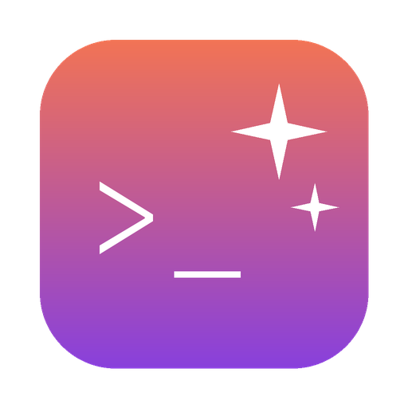

<p align="center"></p>

# CLI Assistant

Raycast Pro olmadan Raycast'te yapay zekâ: soru sor, sohbet et, seçili metni düzelt, çevir, özetle. İstekler, bilgisayarında kurulu ve kendi Claude hesabınla giriş yapmış [Claude Code](https://code.claude.com) CLI'si üzerinden gider. Kullanım Raycast AI kredisinden değil, Claude planının kotasından düşer.

> Bu proje Anthropic veya Raycast ile bağlantılı değildir; Anthropic tarafından geliştirilmemiş ya da onaylanmamıştır.

## Komutlar

| Komut | Ne yapar |
| --- | --- |
| **Soru Sor** | Soruyu ana aramadan alır, cevap akarak gelir. Fallback komutu olarak eklenebilir. |
| **Sohbet** | Devam soruları sorabileceğin sohbet. |
| **Sohbet Geçmişi** | Önceki sohbetleri açar veya siler. |
| **Seçim Hakkında Sor** | Seçili metin hakkında soru sorar. |
| **Yazımı Düzelt** · **Metni İyileştir** · **Metni Kısalt** | Seçili metni dönüştürüp seçimin yerine yapıştırır. |
| **Çevir** | Yazdıkça çevirir; seçili metin kendiliğinden gelir. Hedef dil hatırlanır. |
| **Çevir ve Değiştir** | Seçili metni pencere açmadan çevirip yerine yapıştırır. |
| **Özetle** · **Açıkla** | Seçili metni (seçim yoksa panodakini) özetler veya açıklar. |

**Model seçimi:** Sohbet ve Çevir'de arama çubuğundaki menüden, cevap ekranında <kbd>⌘</kbd><kbd>⇧</kbd><kbd>R</kbd> ile. Liste sabit değil, Claude Code CLI'den planına göre gelir (yeni modeller kendiliğinden görünür). Seçilen model tüm komutlarda ortaktır ve hatırlanır; sohbetin ortasında değiştirince bağlam korunur.

Cevap ekranında: <kbd>↵</kbd> ön uygulamaya yapıştır, <kbd>⌘</kbd><kbd>↵</kbd> sohbette devam et, <kbd>⌘</kbd><kbd>⇧</kbd><kbd>C</kbd> kopyala, <kbd>⌘</kbd><kbd>R</kbd> yeniden üret, <kbd>⌘</kbd><kbd>⇧</kbd><kbd>R</kbd> başka modelle sor (seçim kalıcı olur), <kbd>⌘</kbd><kbd>.</kbd> durdur.

## Gereksinimler

- macOS üzerinde Raycast v2
- [Claude Code](https://code.claude.com/docs/en/quickstart) kurulu ve ücretli bir Claude planıyla giriş yapılmış:

  ```bash
  curl -fsSL https://claude.ai/install.sh | bash
  claude   # ardından /login
  ```

## Kurulum

Terminale yapıştır:

```bash
curl -fsSL https://raw.githubusercontent.com/umitaltintas/raycast-cli-assistant/main/install.sh | bash
```

Node, npm veya git gerekmez. Betik son [release](https://github.com/umitaltintas/raycast-cli-assistant/releases/latest)'teki hazır derlemeyi (~60 KB) indirir, Raycast'in eklenti klasörüne koyar ve Raycast'e kaydettirir. Claude Code'un kurulu ve giriş yapılmış olduğunu da kontrol eder. **Güncellemek için aynı komutu tekrar çalıştır;** sohbet geçmişi ve ayarlar korunur. Kaldırmak için Raycast'te komutlardan birinde <kbd>⌘</kbd><kbd>K</kbd> → *Uninstall Extension*.

> Mağaza dışı eklentiler Raycast'te "geliştirme eklentisi" olarak görünür ve Raycast hesabıyla giriş yapılmış olmasını gerektirebilir. Betik, `ray develop`'un Raycast'e gönderdiği kayıt bildiriminin (`raycast://cli/…`) aynısını kullanır; bu Raycast'in belgelenmiş bir arayüzü olmadığından ileride değişirse aşağıdaki kaynaktan kurulum her zaman çalışır.

<details>
<summary>Kaynaktan kurulum (geliştirmek istersen)</summary>

```bash
git clone https://github.com/umitaltintas/raycast-cli-assistant.git
cd raycast-cli-assistant
npm install
npm run dev   # eklenti Raycast'e eklendikten sonra Ctrl+C ile durdurabilirsin
```

Node 22.22.2 veya üstü gerekir.

</details>

İpuçları:

- **Soru Sor**'u Raycast ayarlarından fallback komutu yap: ana aramaya yazdığın, hiçbir komutla eşleşmeyen metin ↵ ile doğrudan soruya dönüşür.
- Sık kullandığın komutlara (Çevir ve Değiştir, Yazımı Düzelt) hotkey ata.

## Ayarlar

| Ayar | Açıklama |
| --- | --- |
| Varsayılan Model | Haiku, Sonnet, Opus, Fable (takma adlar; her zaman ailenin en yeni sürümü). Uygulama içinde seçtiğin model bunun yerine geçer. |
| Ek Modeller | Planının listesinde görünmeyen modeller için, virgülle ayrılmış (ör. `claude-opus-5-5[1m]`). |
| Claude CLI Yolu | Boşsa `~/.local/bin`, `/opt/homebrew/bin`, `/usr/local/bin` denenir |
| Ek Talimat | Her isteğe eklenen kişisel talimat (üslup, hitap vb.) |

## Nasıl çalışır

Her istek `claude -p` ile, akış (`stream-json`) modunda çalıştırılır. Claude Code bir kodlama ajanı olduğu için sohbet asistanına gerekmeyenler kapatılır:

- araçlar (`--tools ""`), MCP sunucuları (`--strict-mcp-config`), ayar dosyaları (`--setting-sources ""`) ve slash komutları kapalı;
- Claude Code'un kodlama sistem talimatı yerine kısa bir asistan talimatı (`--system-prompt`).

Bu, ilk cevaba kadar geçen süreyi ölçümümde ~9 sn'den ~3 sn'ye indiriyor. `--bare` daha hızlı olurdu ama yalnızca API anahtarıyla çalışıyor, Claude hesabı girişini okumuyor.

Diğer ayrıntılar:

- **Sohbetler** Claude Code oturumlarıdır (`--session-id` / `--resume`). Oturum dosyaları gerçek projelerine karışmasın diye eklentinin kendi klasöründe tutulur.
- **Proxy:** `--setting-sources ""` kullanıcı ayarlarını atladığı için `~/.claude/settings.json` içindeki `HTTPS_PROXY` / `HTTP_PROXY` / `NO_PROXY` değerleri eklenti tarafından okunup CLI'ye verilir.
- **Raycast ortamı:** Raycast eklenti süreçlerinde `USER` / `LOGNAME` tanımlı değil; Claude Code bunlar olmadan anahtar zincirindeki girişi bulamayıp `Not logged in` diyor. Eklenti bu değişkenleri kendisi tanımlar.
- **Çeviri yönü:** "Otomatik (TR ↔ EN)" kararı modele bırakılmaz, metnin Türkçe olup olmadığına eklenti karar verir; modele her zaman tek bir hedef dil gider.
- **Model listesi:** CLI'nin kontrol protokolüne (Agent SDK'nin `supportedModels()`'inin kullandığı `initialize` isteği) sorulur; model çağrısı yapılmaz, ~1 sn sürer. Sonuç önbelleğe alınır, günde bir arka planda yenilenir; CLI'ye ulaşılamazsa takma adlardan oluşan yedek liste kullanılır.
- `ANTHROPIC_API_KEY` ortamda tanımlıysa CLI üyelik yerine onu kullanacağı için çocuk süreçten silinir.

## Kullanım koşulları

Eklenti kimlik bilgisi toplamaz, saklamaz ve aktarmaz; yalnızca senin kurduğun, değiştirilmemiş Claude Code CLI'sini çalıştırır ve giriş Anthropic'in kendi akışıyla yapılır. Kullanımın [Anthropic'in koşullarına](https://code.claude.com/docs/en/legal-and-compliance) ve planının sınırlarına tabidir.

## Lisans

MIT
